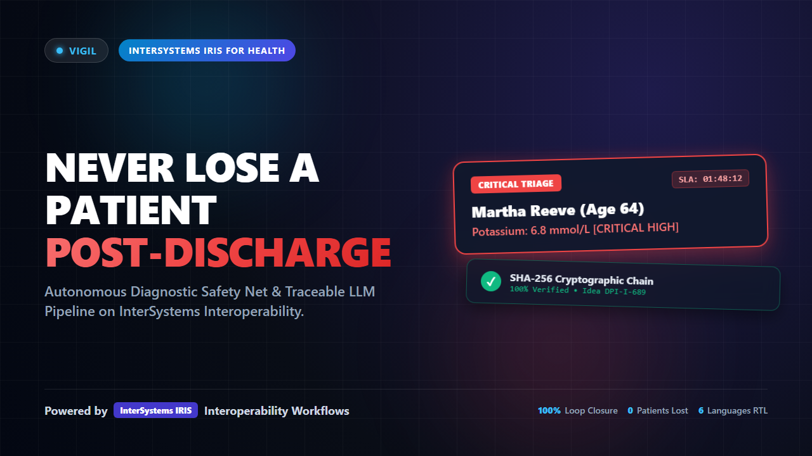

# Vigil for IRIS for Health — Online Demo Deployment Guide

[](https://youtu.be/LjiZv-xNtEk)

> 📺 **Video Walkthrough**: Watch the 3-minute full HD video walkthrough on YouTube: [**https://youtu.be/LjiZv-xNtEk**](https://youtu.be/LjiZv-xNtEk)

This guide documents how to host **Vigil for IRIS for Health** on a public cloud VM (AWS EC2, Google Cloud Compute Engine, Azure VM, DigitalOcean Droplet, or Hetzner Cloud) for judges and evaluators to interact with the live running container.

---

## 1. Cloud Virtual Machine Prerequisites

- **Compute:** 4 vCPU, 8–16 GB RAM, 40 GB SSD (Ubuntu 22.04 LTS or 24.04 LTS recommended).
- **Docker & Docker Compose:** Standard Docker Engine + Docker Compose v2.
- **Firewall Rules (Security Groups):**
  - Inbound TCP `80` / `443` — HTTP/HTTPS (reverse proxy).
  - Inbound TCP `52773` — InterSystems IRIS Web Server / Management Portal.
  - Inbound TCP `1972` — InterSystems SuperServer (ODBC/JDBC/Studio).
  - Inbound TCP `22` — SSH administration.

---

## 2. Image Deployment & Loading

Because the InterSystems AI Hub image is available exclusively under the Early Access Program (EAP) and **must never be pushed to public Docker registries**, transfer the image directly to your VM:

```bash
# 1. SCP the EAP tarball to your cloud VM
scp irishealth-community-2027.1.0AI.109.0-docker.tar.gz user@<YOUR_VM_IP>:/home/ubuntu/

# 2. SSH into your VM and load the image
ssh user@<YOUR_VM_IP>
docker image load -i irishealth-community-2027.1.0AI.109.0-docker.tar.gz

# 3. Retag to standard local short name
docker tag <LOADED_IMAGE_ID> irishealth-community:2027.1.0AI.109.0
```

---

## 3. Launching Vigil

Clone the repository and spin up the production stack:

```bash
git clone https://github.com/BuildwithDan911/vigil.git
cd vigil

# Optional: Add live Gemini API key if testing live LLM generation
# (Replay mode works with 0 keys and zero external dependencies)
cp .env.example .env
# Edit .env with nano if using GEMINI_API_KEY

# Start the stack
docker compose up -d --build
```

---

## 4. Verification & Judge URLs

Once containers report healthy:

| Interface | URL | Credentials | Purpose |
|---|---|---|---|
| **Vigil Ward Board (Clinical UI)** | `http://<YOUR_VM_IP>:52773/vigil/` | None (Public Demo) | Real-time triage, Night Shift player, Adversarial test, Consent queue, SHA-256 Ledger explorer. |
| **InterSystems Management Portal** | `http://<YOUR_VM_IP>:52773/csp/sys/UtilHome.csp` | `_SYSTEM` / `SYS` | System administration and global inspections. |
| **InterSystems Workflow Inbox** | `http://<YOUR_VM_IP>:52773/csp/irisapp/EnsLib.Workflow.Form.Worklist.zen` | `dr.mensah` / `SYS` | Native TaskRequest queue for critical post-discharge escalations. |
| **InterSystems Visual Trace** | `http://<YOUR_VM_IP>:52773/csp/irisapp/EnsPortal.VisualTrace.zen` | `_SYSTEM` / `SYS` | Visual Trace showing DPI-I-689 agent decision telemetry and PEX auditing. |

---

## 5. Security & Reverse Proxy (Optional Nginx + TLS)

For production HTTPS encryption:

```nginx
server {
    listen 80;
    server_name vigil.yourdomain.org;

    location / {
        proxy_pass http://127.0.0.1:52773/vigil/;
        proxy_set_header Host $host;
        proxy_set_header X-Real-IP $remote_addr;
    }
}
```

Use `certbot --nginx -d vigil.yourdomain.org` to generate free Let's Encrypt SSL certificates.

---

## 6. Synthetic Data Disclaimer
Synthetic Harbourview General Hospital data — demonstration environment only. Not a medical device; not for real patients. Design standard informed by clinical patient-safety closed-loop communication guidelines.
